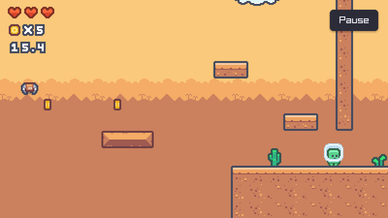
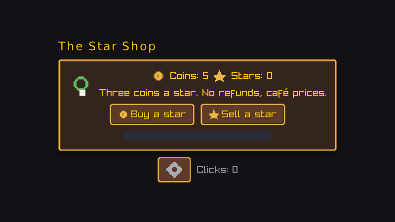
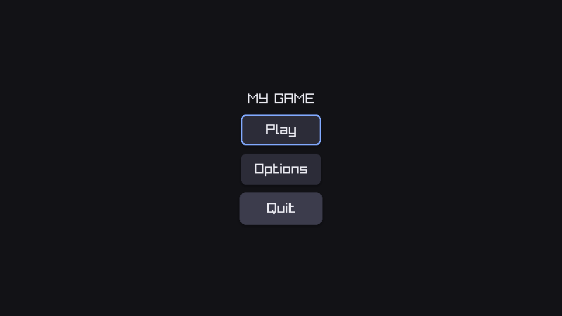
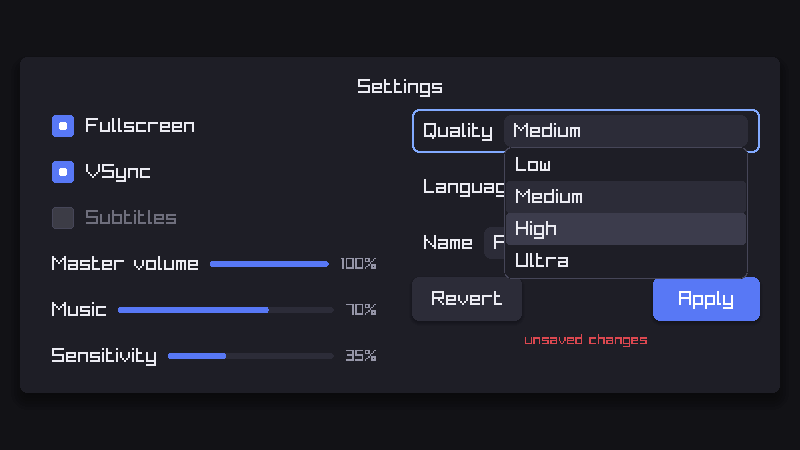
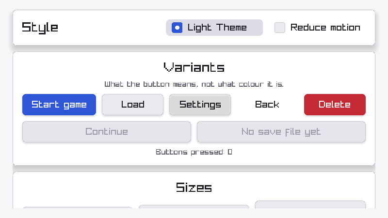
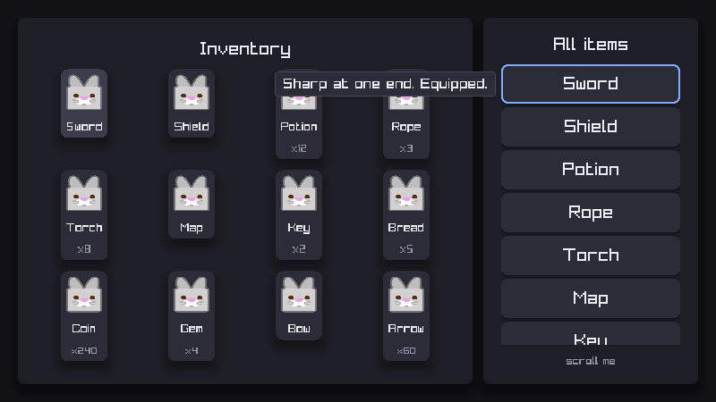
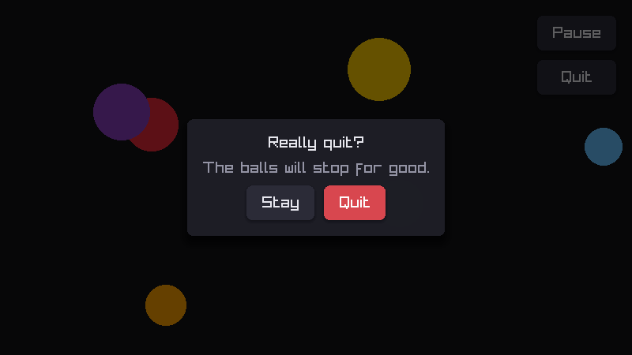
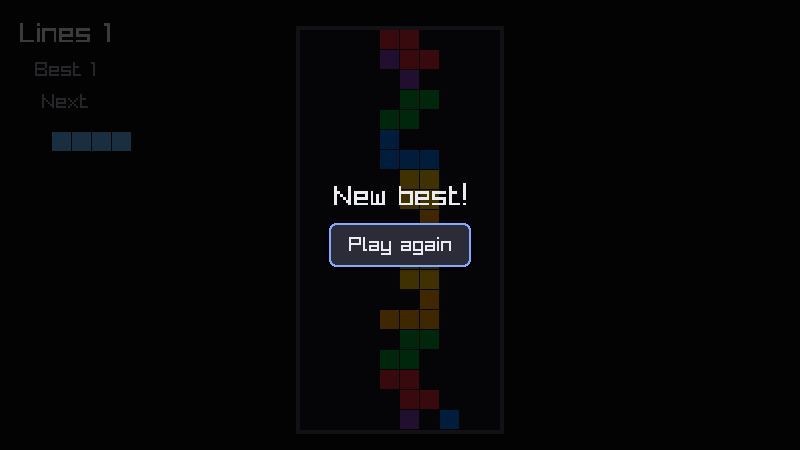
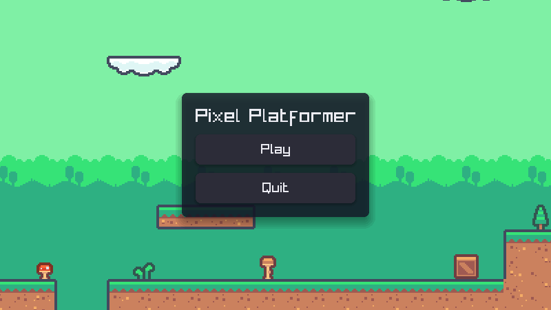
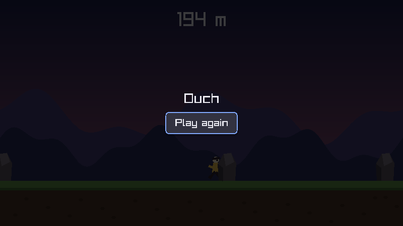

# raylib_multiplatform

**📖 Documentation: <https://omardev29.github.io/rmp-docs/>** — a tutorial that builds a game
from nothing to a release, the manual, the examples (most of them playable in the browser),
publishing, and the reference. Every C and C++ block there is compiled against this repository.

> [!WARNING]
> **This is experimental only, and it is not for production.** The pipeline is green and the render gates
> are real, but the features are very experimental and not intended to production

A **C++20** framework for shipping [raylib](https://www.raylib.com/) games to 17 targets from one
codebase — Windows, Linux, macOS, Web, Android, iOS and the three BSDs — with a CI pipeline that
builds them, **boots them, and checks they actually put pixels on screen**.

<p align="center">
  
  
</p>
<p align="center">
  
  
  
</p>
<p align="center">
  
  
  
</p>

Every picture on this page is a frame the CI draws and compares pixel for pixel on every commit:
the games and menus are played from scripts, and a shot that moves fails the build.

---

## A main menu is three functions

```cpp
rmp::ui::begin();
if (rmp::ui::button("Play")) play();
if (rmp::ui::button("Quit")) quit();
rmp::ui::end();
```

Centred, sized for the screen it is on, and playable with a mouse, a finger, a keyboard or a
gamepad without a line about any of them. That is the benchmark for every API here: anything that
would make it longer is redesigned until it does not.

When a screen is *designed* rather than written, the same controls are widgets you keep, Godot
style — each with its own look, sounds and callbacks:

```cpp
rmp::ui::Button buy{
    .text = "Buy a star",
    .icon = rmp::ui::slice(skin, "coin"),          // a slice of an Aseprite file
    .style = { .skin = rmp::ui::nine_slice(skin, "button"),
               .shadow = rmp::ui::Shadow{},
               .sounds = { .click = "coin" } },
    .on_click = [this] { if (!spend(3)) buy.shake(); },
};
```

Themes, styles that children inherit, nine-slices, per-state skins, soft shadows, text outlines,
motion (hover, press, appear, shake), any font with any letter baked on demand, overlays that
blur the game behind them, tooltips and notices.

## A level from LDtk, and the objects in it

<p align="center">
  
  
</p>

```cpp
void LevelScene::_ready() {
    map = rmp::assets::load_map("world.ldtk");                // drawn and collided by the scene
    map.on_object("Coin", [](rmp::Scene &s, const rmp::MapObject &o) {
        s.spawn<Coin>({ .position = o.position }).value = o.property_int("value", 1);
    });

    auto &player = spawn<Player>({ .position = { 64, 64 }, .size = { 14, 22 } });
    player.add<rmp::behavior::Platformer>({ .jump = 700, .air_jumps = 1 });
    player.sprite.sheet = rmp::assets::load_sheet("hero.aseprite");
    camera.follow = player.handle();
}
```

Levels are placed, linked and tuned in [LDtk](https://ldtk.io) (or Tiled); sprites are Aseprite
files with their tags as animations. The behaviours — `Platformer`, `TopDown`, `Runner`, `Ball`,
`Projectile`, `Follow`, `Tween`, `Parallax`, `Spawner`, `Health`… — are one `add<>()` each, and the
seven games in `examples/games/` (Pong to the platformer) are each playable start to finish.

## Input, sound, saves, tuning

```cpp
rmp::input::action("jump", KEY_SPACE, KEY_W, GAMEPAD_BUTTON_RIGHT_FACE_DOWN);
if (rmp::input::just_pressed("jump")) rmp::audio::play("jump");
rmp::audio::music("level1");

rmp::Value best;
rmp::save::read("records", best);                 // every read has a default
best["coins"] = std::max(best["coins"].as_int(0), coins);
rmp::save::write("records", best);                // the right folder on every platform

static rmp::Value tuning = rmp::assets::load_value("tuning.json");
if (tuning.changed()) tuning.reload();            // edited while the game runs: hot reload
```

Actions with any number of bindings, routed away from the game while the interface wants the
pointer; sounds and music by name, whatever the format; saves as real structures, sealed if you
like; JSON and textures that reload when you save them in your editor, in a debug build.

---

## One command, every platform

```bash
rmp new my_game              # a game of your own, with the framework and CI for every target
rmp run                      # build (debug) and play
rmp test                     # the .toml, the pins, the licences, a frame drawn, a boot
rmp build release            # the build players get
rmp web                      # or: rmp android
rmp build windows            # the Windows .exe, from Linux (MinGW-w64, or clang-cl)
rmp run windows              # ...started under Wine
rmp package android          # what a release ships, made here: desktop, windows, web, android
rmp deploy 1.2.3             # tag a release; CI builds all 17 targets and publishes them
```

- **One config file**, `raylib_multiplatform.toml`, generates the CMake, Gradle and Xcode inputs,
  so they cannot drift; an invalid one fails in a second, naming the line.
- **Fast debug builds**: in a new game, the C of raylib and its libraries is compiled by tcc when
  it is installed, many times faster than GCC or Clang.
- **A development container** (`.devcontainer/`) that is the build image CI uses, with a desktop
  in the browser: open the repository in VS Code or a Codespace and `rmp run` works.
- **CI that proves things**: every target built, the desktop, web, Android, iOS-simulator and BSD
  builds booted and a frame read back, the games and menus played from scripts and compared
  exactly, sanitizers, fuzzing, property tests, coverage that only rises, size budgets per
  binary, and a licence check that fails on anything copyleft. What each target gets:
  [What CI covers](https://omardev29.github.io/rmp-docs/publishing/ci.html).
- **Releases** are a git tag, and the build is refused while your application id is still `com.example.*`, so you cannot cut your first release under a placeholder identity you can never change.
  Google Play, the App Store, itch.io and the rest:
  [Publishing](https://omardev29.github.io/rmp-docs/publishing/).

---

## Quick start

```bash
curl -fsSL https://omardev29.github.io/rmp-docs/install.sh | sh     # Linux, macOS
irm https://omardev29.github.io/rmp-docs/install.ps1 | iex          # Windows, in PowerShell
```

Then, in a new terminal, `rmp new my_game`, `cd my_game`, `rmp run`. You need **Python 3.11+**,
**CMake**, **Ninja** and a C++ compiler; on Linux the X11 development libraries too:

```bash
sudo apt install libx11-dev libxrandr-dev libxi-dev libxcursor-dev libxinerama-dev libgl1-mesa-dev
```

On a Linux console with no desktop, `rmp` builds for DRM/KMS instead — straight to the screen, no
X11 — and needs these in their place:

```bash
sudo apt install libdrm-dev libgbm-dev libegl1-mesa-dev libgles2-mesa-dev
```

The rest — the BSDs, a clone of your own, uninstalling — is in
[Install](https://omardev29.github.io/rmp-docs/getting-started/install.html), and the first game
step by step in the [tutorial](https://omardev29.github.io/rmp-docs/getting-started/).

---

### What we add on top of raylib

All of raylib's API is there: `DrawTexture`, `LoadModel`, `IsKeyPressed`, everything. The copy in
`thirdparty/raylib/` is raylib 6.2 with local patches, all listed in
[`thirdparty/raylib/PATCHES.md`](thirdparty/raylib/PATCHES.md) and marked at each site, none of
them changing a signature. On top of it, a few small namespaces, all under `rmp::`:

| Namespace | What it is for |
| --- | --- |
| **`rmp::app`** | The entry point, and `quit()` that is right on every platform; what outlives a scene; a window that is not the design size, letterboxed or expanded. [Manual](https://omardev29.github.io/rmp-docs/manual/core/app.html) |
| **`rmp::Scene`** | State, update and drawing on a stack: change, push, pop. A pause menu is a scene pushed on top. [Manual](https://omardev29.github.io/rmp-docs/manual/core/scenes.html) |
| **`rmp::Object`** | What lives in a scene: position, velocity, a shape or a sprite, collision layers, `on_click`, and the sweeps, separation and raycasts done for you. [Manual](https://omardev29.github.io/rmp-docs/manual/core/objects.html) |
| **`rmp::behavior`** | `TopDown`, `Platformer`, `Runner`, `Ball`, `Projectile`, `Follow`, `Tween`, `GridSnap`, `Parallax`, `Spawner`, `Timer`, `Lifespan`, `Health`: one `add<B>({...})` each. [Manual](https://omardev29.github.io/rmp-docs/manual/core/behaviors.html) |
| **`rmp::Camera`** | `follow`, `limits`, `smoothing` that is the same at 30 and 144 Hz, and `shake()`. [Manual](https://omardev29.github.io/rmp-docs/manual/core/camera.html) |
| **`rmp::input`** | Named actions, axes and vectors, routed away from the game while the UI wants the pointer. [Manual](https://omardev29.github.io/rmp-docs/manual/modules/input.html) |
| **`rmp::ui`** | Menus, HUDs, settings screens and shops, simple calls or widgets you keep, themes and styles, overlays, tooltips and notices. [Manual](https://omardev29.github.io/rmp-docs/manual/modules/ui.html) |
| **`rmp::assets`** | Loading by name from loose files or a packed, encrypted `.rres`; counted handles that release themselves; hot reload of JSON and textures. [Manual](https://omardev29.github.io/rmp-docs/manual/modules/assets.html) |
| **`rmp::Tilemap`** | A level from LDtk or Tiled, drawn, collided and populated through your factories. [Manual](https://omardev29.github.io/rmp-docs/manual/modules/tilemaps.html) |
| **`rmp::audio`** | `play("coin")` and `music("level1")` by name; three volume buses. [Manual](https://omardev29.github.io/rmp-docs/manual/modules/audio.html) |
| **`rmp::save`** | `rmp::Value` saves with a default on every read, in the right folder everywhere. [Manual](https://omardev29.github.io/rmp-docs/manual/modules/saving.html) |
| **`rmp::random`** | Seeded and reproducible. [Manual](https://omardev29.github.io/rmp-docs/manual/modules/random.html) |
| **`rmp::ads`** | Interstitial and rewarded ads on Android, nothing everywhere else, no `#ifdef`s. [Manual](https://omardev29.github.io/rmp-docs/manual/modules/ads.html) |

There is no umbrella header: you include what you use — `rmp/app.h`, `rmp/scene.h`,
`rmp/object.h`, `rmp/behavior.h`, `rmp/input.h`, `rmp/ui.h`, `rmp/assets.h`, `rmp/tilemap.h`,
`rmp/audio.h`, `rmp/save.h`, `rmp/random.h`, `rmp/ads.h`, `rmp/math.h` — and `rmp/config.h`, which
every one of them already carries for you.

Rather write plain C? [`examples/plain_c/src/main.c`](examples/plain_c/src/main.c) is a whole
game with your own `main()` and no `rmp::` anything; in a game made with `rmp new`,
`rm src/main.cpp && rm -r src/rmp/ src/scenes/ tests/game/` and copy it into `src/`. See
[Plain C](https://omardev29.github.io/rmp-docs/manual/raylib/plain-c.html).

---

## Licence

This framework's own code — `src/`, `include/`, `tools/`, `cmake/`, `ios/` and the build files —
is MIT; see [LICENSE](LICENSE).

It is **built on raylib**, which is zlib/libpng licensed and is not ours. This project is not
affiliated with or endorsed by raylib or Ramon Santamaria. The copy it vendors is **modified**,
and every change is listed in [`thirdparty/raylib/PATCHES.md`](thirdparty/raylib/PATCHES.md), as
the zlib licence's second clause requires of altered source versions. Clay, cute_tiled, raymob
and raylib-cpp are likewise modified, and each lists its changes in a `PATCHES.md` of its own.

Every vendored component — down to the libraries raylib bundles — with its licence and whether we
altered it, is in [THIRD_PARTY_LICENSES.md](THIRD_PARTY_LICENSES.md). A release ships the full
notices as `LICENSES.txt` next to the binary, inside the APK, and in the iOS bundle;
`tools/license_db.py --check` fails the build on a copyleft or unknown licence and on an
alteration nobody marked.
